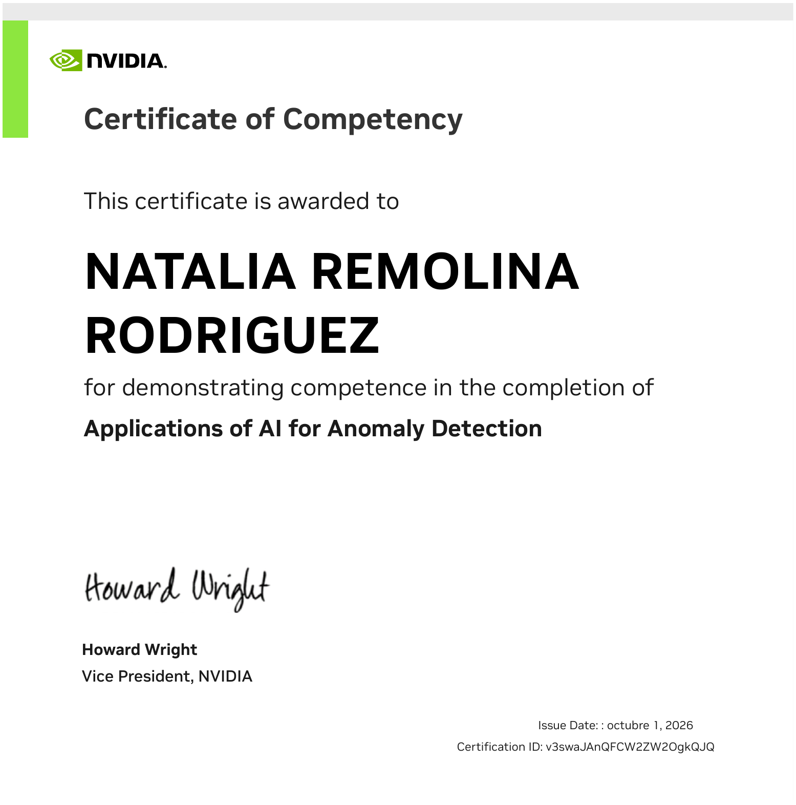

# Applications of AI for Anomaly Detection (NVIDIA DLI)

My study repository for the NVIDIA Deep Learning Institute workshop **Applications of AI for Anomaly
Detection**, which I completed in October 2026. It is a fork of
[HROlive/Applications-of-AI-for-Anomaly-Detection](https://github.com/HROlive/Applications-of-AI-for-Anomaly-Detection),
which holds the lab notebooks; I added my certificate, the slide version from my edition of the
workshop and this summary.

  

**Certificate of Competency**, issued October 1, 2026.
Verify it: <https://learn.nvidia.com/certificates?id=v3swaJAnQFCW2ZW2OgkQJQ>
(Certification ID `v3swaJAnQFCW2ZW2OgkQJQ`; PDF in [`certificado/`](certificado/)).

## What the workshop covers

The running problem is intrusion detection in network traffic, using the **KDD Cup 99** dataset
(about 18 million records, 22 numeric and 9 categorical features). Each lab answers a different
question about how much you know of the data:

| Lab | Situation | Technique | Core idea |
|---|---|---|---|
| 1 | Labels available | **GPU-accelerated XGBoost** (RAPIDS) | Gradient-boosted trees built one after another, each correcting the previous one's errors; binary and then multi-class classification. |
| 2 | No labels | **Autoencoder** | Trained to reconstruct normal traffic only, so a record with a high reconstruction error is suspicious. Categorical features go in through embeddings rather than one-hot encoding. |
| 3 | Unknown anomaly shape, or non-Gaussian data | **GAN** | The generator learns to imitate normal data, and the discriminator ends up as the detector: it gives low probability to whatever does not look normal. |
| Assessment | New dataset | One of the three | Apply a technique and choose the decision threshold. |

All three are compared with **ROC curves and AUC**, and the threshold is set from the share of
anomalies you expect to find.

## What I took from it

- **The labels you have decide the method.** With labels, a supervised model such as XGBoost is hard
  to beat. Without them, an autoencoder turns the question into how "normal" each record looks.
- **The threshold is a business decision**, not a technical detail. Moving it trades false alarms
  for missed anomalies, and the ROC curve makes that trade visible.
- **GPU acceleration changes how you work.** With RAPIDS and XGBoost on GPU you can try many more
  configurations in the same time, which matters most during tuning.
- **How categorical variables enter the model matters.** Moving from one-hot encoding to embeddings
  changes what the model can learn from them.

This connects with my work on model validation (AUC, thresholds, calibration) and with my interest in
high-performance computing applied to AI.

## Repository contents

| Path | What it is |
|---|---|
| [`Lab1-...XGBoost.ipynb`](Lab1-Anomaly%20Detection%20in%20Network%20Data%20using%20GPU-Accelerated%20XGBoost.ipynb) | Lab 1: GPU-accelerated XGBoost |
| [`Lab2-...Autoencoders.ipynb`](Lab2-Network%20Anomaly%20Detection%20using%20Autoencoders.ipynb) | Lab 2: autoencoders |
| [`Lab3-...GANS.ipynb`](Lab3-Anomaly%20Detection%20in%20Network%20Data%20using%20GANS.ipynb) | Lab 3: GANs |
| [`Assessment.ipynb`](Assessment.ipynb) | Final workshop assessment |
| `Lab*-preprocess_data.py`, `Assessment-preprocess_data.py` | KDD Cup 99 preprocessing |
| `Lab*-Presentation.pptx`, `Assessment-Presentation.pptx` | Course slides |
| [`materiales_taller_2026/`](materiales_taller_2026/) | The Lab 1 slide deck used in my 2026 edition of the workshop (44 slides) |
| [`certificado/`](certificado/) | My certificate (PDF and image) |
| `data.tar.gz` | Workshop data |
| `images/` | Figures used in the notebooks |
| [`docs/README_original_HROlive.md`](docs/README_original_HROlive.md) | README of the original repository |

## Credits

- Course material (notebooks, slides, prepared data and figures): **NVIDIA Deep Learning Institute**.
  Official course page:
  [nvidia.com](https://www.nvidia.com/en-us/training/instructor-led-workshops/anomaly-detection/).
- Original repository and executed notebooks:
  [HROlive](https://github.com/HROlive/Applications-of-AI-for-Anomaly-Detection).
- My additions: the certificate, the 2026 slide version and this README.

---

Natalia Remolina · [github.com/NatoRemolina](https://github.com/NatoRemolina)
